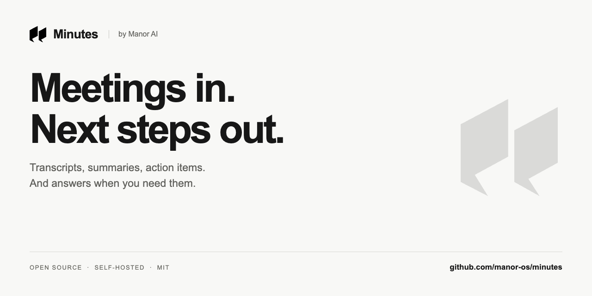
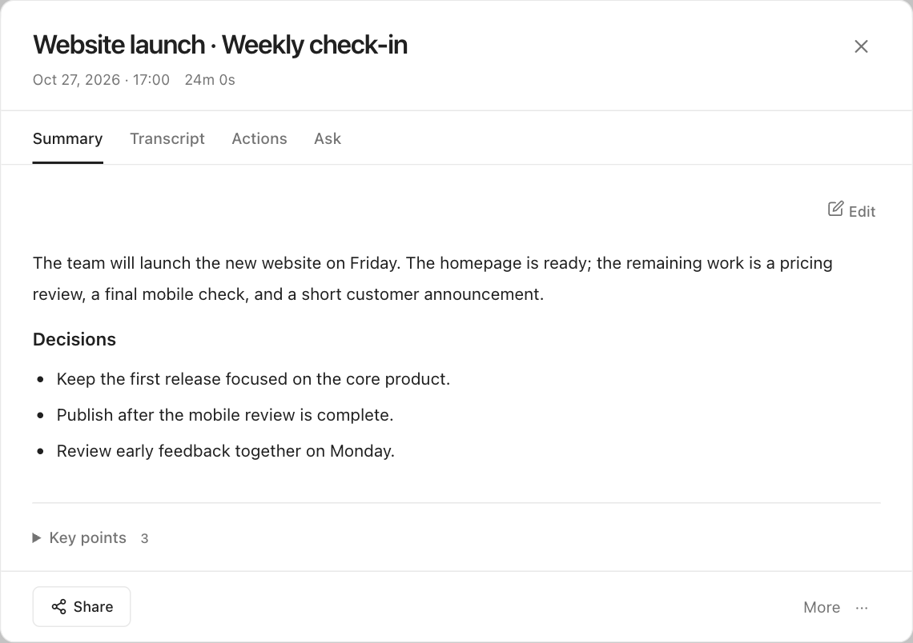
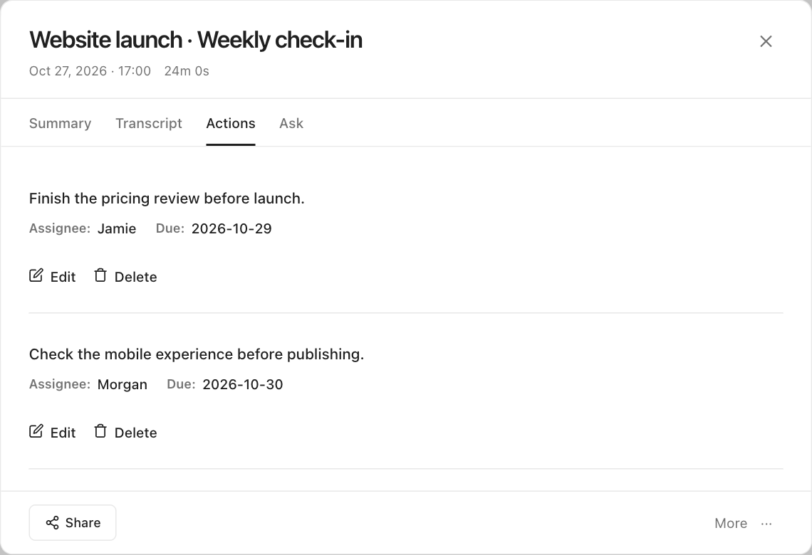
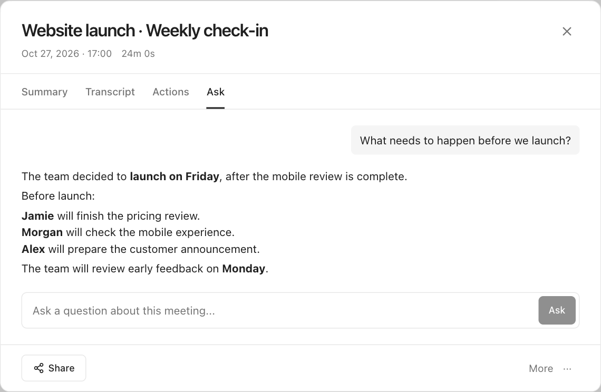

<p align="center">
  
</p>

<p align="center">
  <a href="https://minutes.manorai.xyz/">在线体验</a> ·
  <a href="#自托管">自托管</a> ·
  <a href="CONTRIBUTING.md">参与贡献</a> ·
  <a href="README.md">English</a>
</p>

Minutes 将录音整理成转写、纪要和行动项。你可以追问会议内容、搜索过去的决定，也可以分享会议记录。面向希望减少会后整理工作的创始人和小团队。

使用 Manor 账号体验[在线版](https://minutes.manorai.xyz/)，或在自己的机器上运行 MIT 许可的 Community 开源版。

## 从会议到下一步

- **录音或上传：**录制麦克风，在浏览器支持时同时录制会议标签页音频，也可上传已有录音。
- **整理会议要点：**生成转写、纪要、关键点及包含建议负责人和截止时间的行动项。使用前请核对生成结果。
- **追问会议：**通过 Ask，根据转写内容回答后续问题。
- **整理与搜索：**搜索转写、重命名会议、添加标签或收藏、筛选会议列表。
- **分享与导出：**生成只读分享链接，下载音频或文本，或通过浏览器打印保存 PDF。
- **选择 AI 方案：**使用自己的 API key，或用 faster-whisper 和 Ollama 在自己的设备上进行转写和纪要生成。



<details>
<summary>查看行动项和会议问答</summary>





</details>

截图来自 Community 界面，会议内容和 AI 回答均为演示数据，不含真实用户记录。见[素材来源](docs/launch/ASSETS.md)。

## 在线版与开源版

| | 在线版 Minutes | 本仓库 Community 开源版 |
|---|---|---|
| 开始使用 | [打开网站](https://minutes.manorai.xyz/) | Docker Compose 部署 |
| 账号 | Manor 账号 | 本地邮箱和密码 |
| 转写、纪要、行动项、Ask | 支持 | 支持 |
| AI 处理 | 托管服务，按账号 credits 使用 | 自备 API，或运行本地模型 |
| 纪要和行动项的输出语言选择 | 43 种 | 尚未包含在线版语言选择器 |
| 在 Minutes 内创建 Manor 任务 | 有 Manor 权限时可用 | 未包含该托管集成 |
| Manor MCP 连接 | 托管集成 | 未包含云端 MCP 服务 |
| 数据存储 | 在线服务管理 | 自己部署的服务 |

两个版本独立发布，浏览器兼容性和模型效果也会不同。安装 Community 不包含 Manor 订阅或 credits；源代码使用 MIT 许可，硬件、服务器和 API 可能产生费用。

## 自托管

以下步骤用于本地开发机器，需要 Git、Docker、Docker Compose v2.24 或以上版本。默认配置会开放数据库和存储端口，接入共享网络前请先阅读[部署说明](docs/SELF_HOSTING.md#before-exposing-a-deployment)。

```bash
git clone https://github.com/manor-os/minutes.git
cd minutes
cp .env.community.example .env
```

编辑 `.env`，设置随机 `JWT_SECRET`、自己的 `ADMIN_EMAIL` 和 `ADMIN_PASSWORD`。如果每个用户自己填写 API key，可不配置可选的服务器级密钥。

```bash
docker compose -f docker-compose.yml -f docker-compose.community.yml up -d --build
```

打开 **http://localhost:9002**，使用刚设置的管理员账号登录（或注册独立账号），在 **Settings** 中填写转写和语言模型的凭据，再用短录音或上传文件验证完整流程。

### 本地模型模式

准备好 `.env` 后，用以下命令代替上面的 API 模式启动命令：

```bash
docker compose -f docker-compose.yml -f docker-compose.community.yml -f docker-compose.local.yml up -d --build
docker compose -f docker-compose.yml -f docker-compose.community.yml -f docker-compose.local.yml exec ollama ollama pull qwen2.5:1.5b
```

该配置选择 faster-whisper `base` 和 Ollama `qwen2.5:1.5b`。首次下载镜像、模型需要联网；Whisper 会在第一次转写时下载模型。模型准备好后可在自己的部署中推理，无需付费模型 API。速度、内存和质量取决于硬件及模型。

[完整配置、排错与服务管理 →](docs/SELF_HOSTING.md)

## 录音说明

- 麦克风需要 `localhost` 或 HTTPS。手机通过普通 HTTP 局域网地址访问可能无法录音。
- 包含远端参会者声音时，需分享受支持的浏览器标签页并开启 **Share audio**。系统音频能力取决于浏览器和操作系统。
- 实时文字按片段出现，可能与最终转写不同。在线版单独发布录音修复，移动端表现可能与开源版不同。
- 说话人分离是可选功能，需要额外依赖和配置；“Speaker 1”等标签不代表已确认真实身份。见[说明](docs/SELF_HOSTING.md#speaker-labels)。

## 技术与贡献

React / Vite · FastAPI · Celery / Redis · PostgreSQL · MinIO · faster-whisper / Ollama

欢迎提交问题、文档改进和范围明确的 PR。参见[贡献指南](CONTRIBUTING.md)和[路线图](ROADMAP.md)。反馈时请注明版本、浏览器和部署方式。

Minutes 是 [Manor AI](https://manorai.xyz/) 的一部分。Community 源代码使用 [MIT 许可](LICENSE)。
